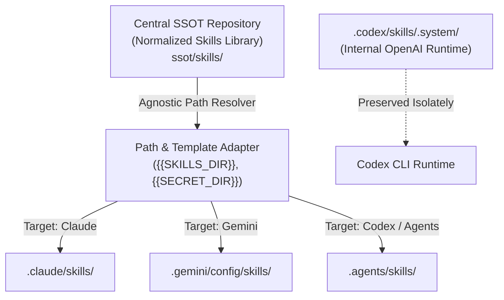

# OmniAgent-OS / Local Agent Skills SSOT

> **OmniAgent-OS is a local-first, fail-closed skill lifecycle manager for AI coding assistants. It explains planned changes, protects unmanaged or modified files, and supports verified rollback and recovery.** Works with Claude Code, OpenAI Codex and Antigravity (Gemini) skill folders.

[](LICENSE)
[](#)
[](#)

---

## 📌 The Problem: The "Siloed Agent" Nightmare

Modern developers increasingly leverage multiple AI coding engines on the same local workstation:
- **Claude Code** for architecture analysis and planning.
- **OpenAI Codex CLI** for rapid implementation, unit tests, and refactoring.
- **Google Antigravity (Gemini)** for multimodal tasks, generative UI, and complex workflows.

However, each agent installs its own fragmented set of skills and isolated memory silos:
- `.claude/skills`
- `.codex/skills` & `.agents/skills`
- `.gemini/config/skills`

### 🔍 Real-World Audit Findings (60,000+ Files Sample)
During our empirical audit of a multi-agent developer workstation, we observed:
1. **The Impact of Embedded Dependencies (`node_modules`):**  
   Copying skill directories across agents ballooned local storage to **60,000+ files (~1.1 GB)**. In our audit sample, **over 85% of these files were nested `node_modules`** inside 7–9 complex skills. These are reproducible dependencies that should be installed on demand rather than duplicated across agent configurations. The actual instructional markdown and source code accounted for **~3,200 files (~55–75 MB)**.
2. **Artificial "Content Drift" (Hardcoded Paths):**  
   Out of 38 skills flagged as differing across agent directories, **31 skills (81.6%) were logically identical**; their only difference was hardcoded directory paths (e.g., `.claude/skills/...` vs `.agents/skills/...` vs `.Codex/secrets/...`).
3. **True Version Drift:**  
   Only **3 skills** in our sample had genuine logic updates (`skill-domain-mcp`, `skill-media-sync`, and `skill-market-analyst`), where the Antigravity/Gemini versions contained enhanced hallucination guards and tracking policies.

---

## 🏛 Architecture: Unified Agent OS



---

## 🚀 Key Features

- **Single Source of Truth (SSOT):** Maintain one canonical copy of skills to eliminate redundant copies across agent directories.
- **Safe Skill Manager MVP:** Inventory, plan, copy, update, and roll back *managed* skill copies. Existing unmanaged skills are never replaced automatically.
- **Smart Path Decoupling (v0.3 beta):** `path_adapter.py` previews explicitly templated references (`{{SKILLS_DIR}}`) and verifies hashes per agent. A guarded, one-skill/one-target rendered `apply` is available for disposable fixtures only; ordinary `apply` refuses to overwrite managed rendered copies without a manifest.
- **Clean Source & Reproducible Dependencies:** Keeps repository source free of committed vendor packages (`node_modules`), with planned hydration scripts for skills requiring local runtime environments.
- **Preserved System Runtimes:** Safely isolates vendor-specific runtimes (e.g., OpenAI `.system` skills) without polluting cross-agent tool registries.
- **Audit & Validation Tooling:** Built-in Python scripts to audit, deduplicate, and verify parity across all local agent installations.

---

## 📂 Repository Structure

```text
├── .gitignore
├── README.md
├── LICENSE
├── audit_skills.py           # Fast SHA-256 hash & line-level unified diff auditor
├── generate_report.py        # Generates markdown audit reports
├── omniagent.py              # Safe discover / plan / adopt / apply / rollback CLI
├── brain.py                  # v0.4 shared second brain: SQLite notes + stdio MCP server
├── path_adapter.py           # v0.3 per-agent template render, adapter-aware plan and adopt
├── adapters.example.json     # Public example; private manifest belongs in .local/
├── scripts/smoke_beta.ps1    # Windows beta smoke test (read-only by default)
├── tests/                    # Synthetic audit, Skill Manager safety, crash and smoke-script tests
├── SKILLS_AUDIT_REPORT.md    # Case study audit report across 4 skill stores
└── ssot/                     # Local SSOT directory (managed locally / .gitignored)
    └── skills/               # Canonical, clean skills library
```

---

## 🛠 Quick Start

### 1. Audit your local environment
Run the non-destructive audit script to inspect your current skills across Claude, Gemini, and Codex:
```powershell
python audit_skills.py --output .local/reports
python generate_report.py --input .local/reports/audit.json
```
Add `--store NAME=PATH` (repeatable) to audit custom skill directories. Run the tests with `python tests/test_audit.py`.

### 2. Inspect Audit Results
The scripts write `audit.json`, `audit_report.md` and `narrative_report.md` to `.local/reports/` (git-ignored, since they contain machine-specific paths and skill names). `SKILLS_AUDIT_REPORT.md` in this repo is a static, anonymized example.

### 3. Manage skills safely (v0.2 preview)

`omniagent.py` only writes to explicitly selected targets. **Plan does not change any files.** It never overwrites an existing unmanaged skill, and it deliberately leaves Codex's internal `.codex/skills/.system` alone. The default mode copies files, so Windows symlink privileges are not required.

Example from PowerShell (run at the repo root):

```powershell
# Read-only: show which standard stores are present (SSOT may be absent).
python omniagent.py discover

# Review changes for a single agent, using your private local SSOT.
$skills = Join-Path $PWD 'ssot\skills'
$claude = Join-Path $HOME '.claude\skills'
python omniagent.py plan --source $skills --target "claude=$claude"

# Read-only: why each skill is safe, blocked or needs opt-in, and how to undo it.
# Add --json for deterministic, path-free output (see docs/USAGE.md).
python omniagent.py plan --source $skills --target "claude=$claude" --explain

# Preview existing unmanaged skills that exactly match the SSOT.
python omniagent.py adopt --source $skills --target "claude=$claude"

# Only record exact matches in private manager state; NO skill files are changed.
python omniagent.py adopt --source $skills --target "claude=$claude" --yes

# For a mismatch, review its SKILL.md diff in your LOCAL terminal only.
python omniagent.py adopt --source $skills --target "claude=$claude" --skill my-skill --diff

# Only after reviewing the plan: install missing skills and update managed,
# unchanged copies. Leave unmanaged skills and local edits untouched.
python omniagent.py apply --source $skills --target "claude=$claude" --yes --skip-blocked

# Copy the transaction ID printed by apply to undo that operation later:
python omniagent.py rollback --transaction 'YYYYMMDDTHHMMSSZ-xxxxxxxxxxxx' --yes
```

For multiple stores, repeat `--target NAME=PATH`, e.g. `--target "agents=$HOME\.agents\skills"`. To deploy just one skill, use `--skill NAME` (repeatable).

**What adoption does:** `adopt` checks an existing target folder against its canonical SSOT copy. Only byte-for-byte matching files and directory structure qualify as `eligible`; others remain `mismatch`, `unsafe`, or `already_managed`. `adopt` without `--yes` is read-only. With `--yes`, it writes **only** `.local/manager/state.json` and a transaction journal. `rollback --transaction ID --yes` for an adoption transaction **untracks** the skill without deleting or rewriting its files.

An adopted skill stays unchanged by subsequent `apply` operations unless you additionally specify `--allow-update-adopted`. This separate opt-in makes upgrading user-owned folders an explicit decision. A `--diff` shows `SKILL.md` text only when exactly one skill and one target are selected; it may reveal private content in your local terminal, and differences in other assets must be inspected separately.

Important safety boundaries:

- Backups, transaction journals, hashes, and machine-specific paths remain under `.local/manager/`, which is excluded from Git. **Back up this folder securely** if you want to keep rollback capability.
- A skill is changed only if previously installed or explicitly adopted *and* its current content still matches the recorded checksum. Updates to adopted folders additionally require `--allow-update-adopted`. Unmanaged collisions and manual edits are blocked; `--skip-blocked` explicitly leaves those entries alone.
- `node_modules`, `.git`, and caches are not copied. Suspected credential files and source symlinks cause a refusal. Dependencies are **not hydrated** yet.
- This preview does not rewrite hardcoded paths inside `SKILL.md`, merge second brains, or manage external agent runtimes. It does not guarantee crash-safe filesystem transactions or coordinate concurrent managers using different state directories.
- The manager serializes writers with an OS mutex. A leftover `manager.lock` is reclaimed only when the OS **confirms its PID is no longer running**; live, reused, or unrecognizable PIDs fail closed and require manual inspection. Never delete an active lock. The ignored `.local/manager/manager.mutex` file may remain after shutdown; that is normal and its OS lock releases automatically.
- On Windows, run the CLI from a normal user PowerShell session; test with disposable `--target` directories before using real agent stores.

Run isolated tests (no third-party Python packages required):

```powershell
python tests/test_audit.py
python -m unittest discover -s tests -p "test_*.py" -v
```

### 4. Preview portable paths and stage a single rendered skill (v0.3 experimental)

Use a **disposable SSOT copy** with explicit placeholders and an opt-in private
manifest, as described in [the Path Adapter guide](docs/PATH_ADAPTER.md). For
example, once your private manifest and fixture are ready:

```powershell
python path_adapter.py --manifest .local/adapters.json `
  --source .local/adapter-fixtures/skills `
  --target "agents=$HOME\.agents\skills" --skill demo-skill --diff

# Compare source_hash, render_hash and installed_hash without changing state:
python omniagent.py plan --adapter-manifest .local/adapters.json `
  --source .local/adapter-fixtures/skills `
  --target "agents=$HOME\.agents\skills" --skill demo-skill --json
```

The two preview commands above do **not** write to agent stores or manager
state. An experimental, opt-in adapter-aware `apply` is available **only for
single-skill/single-target tests on disposable stores**. It requires
`--adapter-manifest`, `--allow-rendered-apply` and `--yes` together; see the
[Path Adapter guide](docs/PATH_ADAPTER.md) for a controlled apply/rollback
fixture. Do not use the public examples to mutate your live private SSOT or
existing agent stores yet.

---

## 📚 Docs

- [docs/PROJECT_CONTEXT.md](docs/PROJECT_CONTEXT.md): why this project exists, design principles, decisions, roadmap
- [docs/CODEBASE_REALITY_CHECK.md](docs/CODEBASE_REALITY_CHECK.md), [docs/COMPETITIVE_STRATEGY.md](docs/COMPETITIVE_STRATEGY.md), [docs/RESEARCH_DRIVEN_ROADMAP.md](docs/RESEARCH_DRIVEN_ROADMAP.md): what is verified, what competitors already cover, what to build next (29/10/2026)
- [docs/DEVELOPMENT_LOG.md](docs/DEVELOPMENT_LOG.md): what was done on a real machine, metrics, lessons
- [docs/USAGE.md](docs/USAGE.md): Skill Manager runbook (discover, adopt, plan, apply, rollback)
- [docs/PATH_ADAPTER.md](docs/PATH_ADAPTER.md): v0.3 template preview, guarded fixture apply and rollback
- [docs/QUICKSTART.md](docs/QUICKSTART.md): 10-minute Windows start, smoke test and troubleshooting
- [docs/BETA.md](docs/BETA.md): controlled beta guide, release criteria and evidence
- [docs/BRAIN.md](docs/BRAIN.md): shared second brain MVP (trust model, usage, what is verified and what is not)
- [docs/RELEASE_NOTES_v0.3.0-beta.1.md](docs/RELEASE_NOTES_v0.3.0-beta.1.md): release notes for the published pre-release

---

## 🗺 Roadmap

- [x] Phase 1: Safe multi-agent configuration backup with zero credential leakage.
- [x] Phase 2: Complete cross-agent skill audit and line-level diff drift analysis.
- [x] Phase 3: Extraction of canonical SSOT structure (local-first).
- [x] Phase 4a: Conservative local Skill Manager MVP (discover, plan, adopt exact matches, copy, rollback).
- [x] Phase 4b preview: Read-only, explicit per-agent path template renderer and drift detection (v0.3a).
- [x] Phase 4b guarded fixture apply: single-skill adapter-aware staging, hash verification and rollback (v0.3b experimental).
- [x] Phase 4b hardening (released as v0.3.0-beta.1): adapter-aware adoption, journaled apply and rollback, `recover`, `fsync`, junction detection.
- [ ] Phase 4b remaining: drift reconciliation for partially converted installs, dependency-aware validation, execution compatibility checks on Codex/Antigravity.
- [ ] Phase 5: Automated dependency hydration for skills with package requirements.
- [~] Phase 6: Cross-Agent Memory Integration via MCP. MVP store and stdio MCP server done (`brain.py`); signed-in Claude Code and Codex used it through per-run flags in a temp project (see docs/BRAIN.md). Registration into the real agents is not applied yet; Antigravity is not verified.
- [ ] Phase 7: Multi-agent coordination: handoff, context sharing, permissions and conflict avoidance (git worktrees).
- [ ] Phase 8: Windows Local Agent OS v1.0: installer/CLI, dependency hydration, health checks, onboarding and release testing.

### Phase và phiên bản

| Phiên bản | Phase trong lộ trình | Nội dung | Trạng thái |
|---|---|---|---|
| v0.2.0 | 4a | Skill Manager MVP | Đã phát hành (tag `v0.2.0`) |
| v0.3.0-beta.1 | 4b | Path Adapter, adopt theo adapter, phục hồi giao dịch | Đã phát hành (pre-release, tag `v0.3.0-beta.1`); 3 skill pilot do chủ dự án tự xác nhận |
| v0.3.x | 4b còn lại, 5 | Hòa giải skill lệch, hydration dependency | Chưa bắt đầu |
| v0.4 | 6 | Shared Second Brain qua MCP | Chưa bắt đầu |
| v0.5 | 7 | Điều phối nhiều agent | Chưa bắt đầu |
| v1.0 | 8 | Windows Local Agent OS | Chưa bắt đầu |

---

## 📄 License
MIT License.
