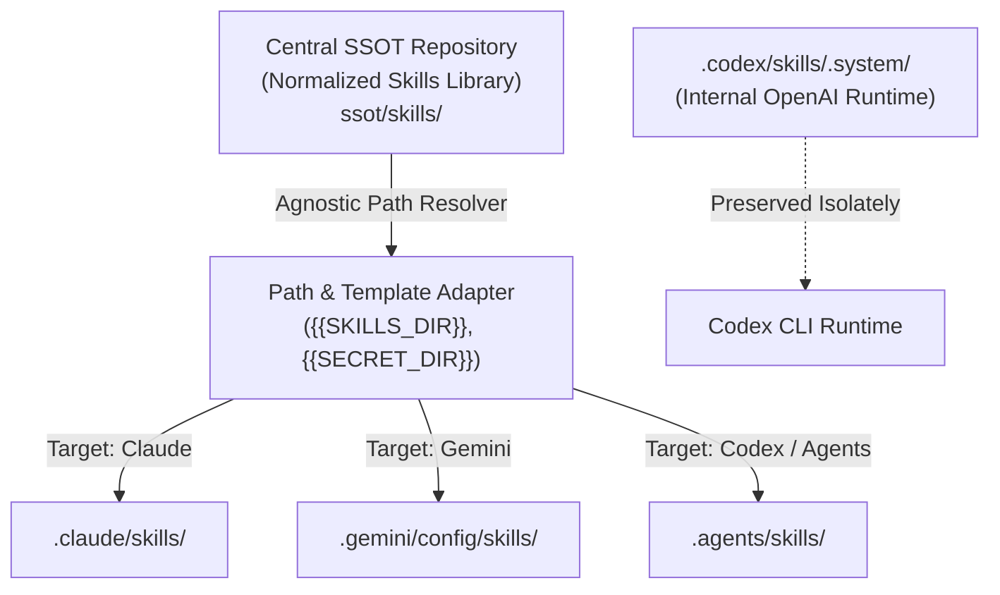

# OmniAgent-OS / Local Agent Skills SSOT

> **A Unified Single-Source-of-Truth (SSOT) & Cross-Agent Management Layer for Claude Code, OpenAI Codex, and Antigravity (Gemini).**

[](LICENSE)
[](#)
[](#)

---

## 📌 The Problem: The "Siloed Agent" Nightmare

Modern developers increasingly leverage multiple AI coding engines on the same local workstation:
- **Claude Code** for architecture analysis and planning.
- **OpenAI Codex CLI** for rapid implementation, unit tests, and refactoring.
- **Google Antigravity (Gemini)** for multimodal tasks, generative UI, and complex workflows.

However, each agent installs its own fragmented set of skills and isolated memory silos:
- `.claude/skills`
- `.codex/skills` & `.agents/skills`
- `.gemini/config/skills`

### 🔍 Real-World Audit Findings (60,000+ Files Sample)
During our empirical audit of a multi-agent developer workstation, we observed:
1. **The Impact of Embedded Dependencies (`node_modules`):**  
   Copying skill directories across agents ballooned local storage to **60,000+ files (~1.1 GB)**. In our audit sample, **over 85% of these files were nested `node_modules`** inside 7–9 complex skills. These are reproducible dependencies that should be installed on demand rather than duplicated across agent configurations. The actual instructional markdown and source code accounted for **~3,200 files (~55–75 MB)**.
2. **Artificial "Content Drift" (Hardcoded Paths):**  
   Out of 38 skills flagged as differing across agent directories, **31 skills (81.6%) were logically identical**; their only difference was hardcoded directory paths (e.g., `.claude/skills/...` vs `.agents/skills/...` vs `.Codex/secrets/...`).
3. **True Version Drift:**  
   Only **3 skills** in our sample had genuine logic updates (`skill-domain-mcp`, `skill-media-sync`, and `skill-market-analyst`), where the Antigravity/Gemini versions contained enhanced hallucination guards and tracking policies.

---

## 🏛 Architecture: Unified Agent OS



---

## 🚀 Key Features

- **Single Source of Truth (SSOT):** Maintain one canonical copy of skills to eliminate redundant copies across agent directories.
- **Smart Path Decoupling:** Replaces brittle hardcoded paths (`.claude/...`, `.agents/...`) with portable references or automated generator renderers.
- **Clean Source & Reproducible Dependencies:** Keeps repository source free of committed vendor packages (`node_modules`), with planned hydration scripts for skills requiring local runtime environments.
- **Preserved System Runtimes:** Safely isolates vendor-specific runtimes (e.g., OpenAI `.system` skills) without polluting cross-agent tool registries.
- **Audit & Validation Tooling:** Built-in Python scripts to audit, deduplicate, and verify parity across all local agent installations.

---

## 📂 Repository Structure

```text
├── .gitignore
├── README.md
├── LICENSE
├── audit_skills.py           # Fast SHA-256 hash & line-level unified diff auditor
├── generate_report.py        # Generates markdown audit reports
├── SKILLS_AUDIT_REPORT.md    # Case study audit report across 4 skill stores
└── ssot/                     # Local SSOT directory (managed locally / .gitignored)
    └── skills/               # Canonical, clean skills library
```

---

## 🛠 Quick Start

### 1. Audit your local environment
Run the non-destructive audit script to inspect your current skills across Claude, Gemini, and Codex:
```powershell
python audit_skills.py
```

### 2. Inspect Audit Results
The script generates `skills_audit_data.json` and `SKILLS_AUDIT_REPORT.md` (kept local by `.gitignore`) to report duplicate counts, hardcoded path drifts, and unique skills per agent.

---

## 🗺 Roadmap

- [x] Phase 1: Safe multi-agent configuration backup with zero credential leakage.
- [x] Phase 2: Complete cross-agent skill audit and line-level diff drift analysis.
- [x] Phase 3: Extraction of canonical SSOT structure (local-first).
- [ ] Phase 4: CLI for symlinking or generating per-agent configs on demand.
- [ ] Phase 5: Automated dependency hydration for skills with package requirements.
- [ ] Phase 6: Cross-Agent Memory Integration via MCP (Memorix / Local Knowledge Graph).

---

## 📄 License
MIT License.
