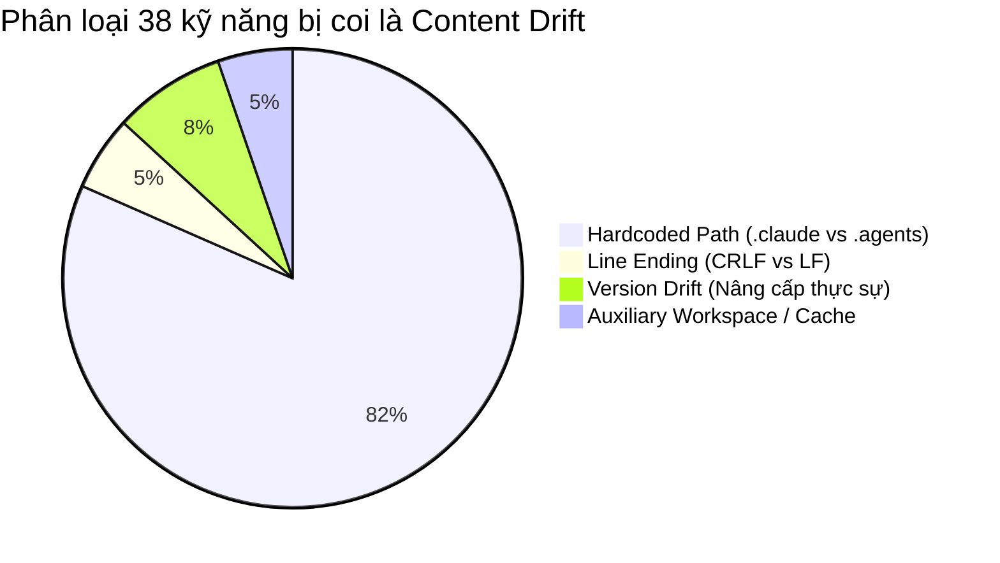
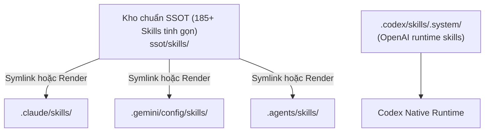

# BÁO CÁO AUDIT & ĐỐI CHIẾU 4 KHO SKILLS (PHASE 2 CASE STUDY)

**Ngày thực nghiệm:** 26/10/2026  
**Dự án:** OmniAgent-OS (Local Agent Skills SSOT)  
**Môi trường thử nghiệm:** Multi-Agent Developer Workstation (Windows Native)

---

## 1. TỔNG QUAN HIỆN TRẠNG 4 KHO SKILLS

| Kho lưu trữ | Đường dẫn cấu hình | Số Skill | Source Files | Vendor Files (`node_modules`) | Dung lượng Source |
|---|---|:---:|:---:|:---:|:---:|
| **Claude** | `~/.claude/skills` | 146 | 2.237 | 14.870 | 44,8 MB |
| **Gemini / Antigravity** | `~/.gemini/config/skills` | 159 | 2.096 | 19.342 | 38,6 MB |
| **Agents / Codex** | `~/.agents/skills` | 186 | 3.085 | 19.368 | 59,9 MB |
| **Codex System** | `~/.codex/skills/.system` | 5 | 48 | 0 | 0,3 MB |
| **TỔNG HỢP TOÀN BỘ** | *(4 kho cộng gộp)* | **191 duy nhất** | **~3.200 file gốc** | **~53.500 file vendor** | **~75 MB code gốc** |

> [!NOTE]
> **Giải mã chênh lệch kích thước và số file (The Vendor Bloat Illusion):**  
> Khi copy thô giữa các agent, tổng số file phình to lên tới hơn **60.000 files (~1,1 GB)** do khoảng **7–9 skills phức tạp chứa sẵn thư mục `node_modules`** cồng kềnh (hơn 53.500 file phụ thuộc bên thứ 3).  
> Mã nguồn và hướng dẫn thực tế của toàn bộ 191 kỹ năng chỉ gồm **~3.200 files** với dung lượng **~75 MB**.

---

## 2. PHÁT HIỆN ĐỘT PHÁ VỀ "CONTENT DRIFT" (LỆCH NỘI DUNG)

Ban đầu, thuật toán băm SHA-256 phát hiện **38 skills** bị lệch mã hash giữa các agent. Tuy nhiên, sau khi chuẩn hóa ký tự xuống dòng và đối chiếu diff:

1. **31 skills thực chất GIỐNG HỆT NHAU VỀ LOGIC (81,6%):**  
   Sự khác biệt duy nhất là các đường dẫn nội bộ bị hardcode theo tên agent (ví dụ: `.claude/skills/...` ở Claude Code bị đổi thành `.agents/skills/...` hoặc `.Codex/secrets/...` ở Codex).
2. **2 skills chỉ lệch Line-Ending:**  
   `brainstorm` và `plans-kanban` giống hệt 100% từng ký tự, chỉ khác do Windows CRLF (`\r\n`) so với Unix LF (`\n`).
3. **Chỉ có 3 skills có sự nâng cấp tính năng thực sự:**
   * `skill-domain-mcp`: Bản tại **Gemini / Antigravity** đã bổ sung quy chuẩn *Canonical Domains & Endpoints* (chống ảo giác).
   * `skill-media-sync`: Bản tại **Gemini / Antigravity** đã bổ sung cơ chế *SKU Management & Reference Corpus Policy*.
   * `skill-market-analyst`: Bản tại **Gemini / Antigravity** đã bổ sung điều khoản *Anti-Hype, Outcome Bias & Trách nhiệm khuyến nghị cũ*.  
   👉 **Kết luận:** Cả 3 skill này đều lấy bản tại **Gemini (Antigravity)** làm chuẩn vì đây là bản hoàn thiện nhất.

---

## 3. PHÂN LOẠI CHI TIẾT 191 SKILLS

### 3.1. Nhóm Trùng khớp Hoàn toàn 100% (122 skills)
* 122 skills này có nội dung `SKILL.md` và mã nguồn đi kèm hoàn toàn đồng nhất giữa các agent (Claude, Gemini, Agents).
* Đây là tập kỹ năng cốt lõi đã ổn định, có thể đưa ngay vào Single Source of Truth mà không cần chỉnh sửa.

### 3.2. Nhóm Lệch Path Hardcode (31 skills - Cần chuẩn hóa đường dẫn tương đối)
* `ads-management`, `analytics`, `ask`, `banner-design`, `chrome-devtools`, `cip-design`, `content-hub`, `copywriting`, `creativity`, `dashboard`, `design`, `docs-seeker`, `feynman`, `hub`, `kanban`, `kit-builder`, `logo-design`, `markdown-novel-viewer`, `marketing-dashboard`, `marketing-planning`, `mcp-management`, `preview`, `scout`, `seo`, `seo-cluster`, `skill-creator`, `threejs`, `ui-ux-pro-max`, `youtube-thumbnail-design`.
* **Giải pháp:** Chuyển các đường dẫn tĩnh `.claude/` hoặc `.agents/` thành đường dẫn trung lập hoặc dùng biến môi trường `$AGENT_HOME`.

### 3.3. Nhóm Kỹ năng Độc nhất (Unique Skills)

#### A. Độc nhất tại `Claude` (1 skill)
* `reverse-engineer-anything`: Kỹ năng dịch ngược và phân tích hệ thống.

#### B. Độc nhất tại `Codex System` (4 skills)
* `imagegen`: Tạo ảnh bằng mô hình OpenAI / DALL-E.
* `openai-docs`: Tra cứu tài liệu chính thức OpenAI Codex.
* `review-agent`: Bộ review mã nguồn tự động của OpenAI.
* `skill-installer`: Script tự động cài đặt skill của Codex.
*(4 skill này là runtime nội bộ của Codex, cần giữ nguyên trong `.codex/skills/.system`).*

#### C. Độc nhất tại `Agents` (26 skills)
Chủ yếu là bộ kỹ năng phát triển Cloudflare & Workers cùng một số file rác:
* **Bộ Cloudflare:** `cloudflare`, `cf-cli`, `cloudflare-email-service`, `cloudflare-one`, `cloudflare-one-migrations`, `durable-objects`, `nextjs-on-cloudflare`, `turnstile-spin`, `workers-best-practices`, `workers-profiling`, `wrangler`.
* **Bộ Framework & Sandbox:** `agents-sdk`, `basin`, `k2`, `sandbox-migrate-to-next`, `sandbox-next`, `sandbox-stable`, `web-perf`.
* **Bộ Command shortcut:** `source-command-ckm-dashboard`, `source-command-ckm-dashboard-check`, `source-command-ckm-docs-init`, `source-command-ckm-journal`, `source-command-ckm-watzup`, `source-command-ckm-worktree`.

#### D. Độc nhất tại `Gemini` (0 skill)
* Tất cả 159 skills của Gemini đều đã có mặt trong Claude hoặc Agents.

---

## 4. MA TRẬN KHUYẾN NGHỊ CHO PHASE 3 (HỢP NHẤT & AGENT OS SSOT)

### Các bước thực thi:
1. **Thiết lập kho SSOT:** Khởi tạo kho chuẩn tại `ssot/skills/` gom đủ các skills độc nhất.
2. **Chọn bản tốt nhất cho 3 skills nâng cấp:** Lấy phiên bản của `gemini` cho các skill đã cập nhật guardrails.
3. **Bảo tồn runtime hệ thống của Codex:** Giữ nguyên 4 runtime skills trong `.codex/skills/.system` để Codex CLI hoạt động ổn định.
4. **Chuẩn hóa đường dẫn:** Thay thế các đường dẫn hardcode `.claude/skills/` bằng định dạng tương đối hoặc template render để tương thích 100% với cả 3 agent.
